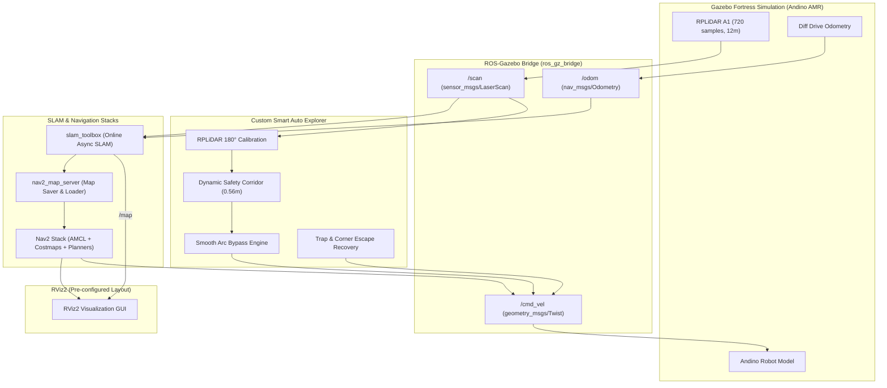

# 🚀 ROS 2 Autonomous SLAM & Navigation with Andino AMR

<div align="center">

[](https://docs.ros.org/en/humble/)
[](https://gazebosim.org/)
[](https://www.docker.com/)
[](https://www.python.org/)
[](https://github.com/SteveMacenski/slam_toolbox)
[](https://navigation.ros.org/)

<p align="center">
  <b>A comprehensive, production-ready framework for 2D SLAM, intelligent autonomous exploration, and Nav2 navigation for mobile robots in ROS 2.</b>
</p>


</div>

---

## 📑 Table of Contents

- [Overview](#-overview)
- [Key Features](#-key-features)
- [System Architecture](#-system-architecture)
- [Sensor Calibration & Mathematical Model](#-sensor-calibration--mathematical-model)
- [Quick Start Guide](#-quick-start-guide)
  - [Prerequisites](#prerequisites)
  - [Running the Autonomous Pipeline](#running-the-autonomous-pipeline)
- [Workflow Details](#-workflow-details)
  - [1. Autonomous SLAM Mapping](#1-autonomous-slam-mapping)
  - [2. Saving the Map](#2-saving-the-map)
  - [3. Nav2 Autonomous Navigation](#3-nav2-autonomous-navigation)
- [Project Directory Structure](#-project-directory-structure)
- [Key ROS 2 Topics & Services](#-key-ros-2-topics--services)
- [Troubleshooting & Tips](#-troubleshooting--tips)
- [Credits & Acknowledgements](#-credits--acknowledgements)

---

## 🌟 Overview

This repository provides an autonomous mobile robotics environment featuring the **Andino AMR** (Autonomous Mobile Robot) in **Gazebo Fortress** and **ROS 2 Humble**.

Equipped with a custom **Smart Autonomous Explorer Node** (`auto_explore.py`), the robot autonomously roams unknown environments, detects dynamic and static obstacles, navigates tight corridors, and maps the entire warehouse without any manual teleoperation. Once mapped, the environment is loaded into the **Nav2** stack for autonomous point-to-point goal navigation, obstacle avoidance, and path planning.

---

## ✨ Key Features

- 🤖 **Smart Autonomous Exploration**: Self-driving wanderer node with obstacle avoidance, smooth arc contour steering, and corner trap escape recovery.
- 📐 **Rigorous Sensor Frame Calibration**: Solves the physical RPLiDAR $180^\circ$ yaw mounting inversion using real-time Cartesian transforms into `base_link`.
- 🗺️ **State-of-the-Art 2D SLAM**: Powered by `slam_toolbox_online_async` with online pose-graph optimization and robust loop closure.
- 🎯 **Complete Nav2 Integration**: Global & local costmaps, DWB trajectory controller, AMCL particle filter localization, and behavior recovery trees.
- 🖥️ **Pre-Configured RViz2**: Custom layout displaying Map, LaserScan, TF frames, and costmap layers with no manual setup needed.
- 🐳 **100% Dockerized**: Zero dependency headaches. Everything runs in isolated Ubuntu 22.04 + ROS 2 Humble containers.
- ⚡ **One-Click Shell Runners**: Five dedicated scripts (`./1_start_sim.sh` to `./5_start_navigation.sh`) for seamless execution.

---

## 🏗️ System Architecture



---

## 🧮 Sensor Calibration & Mathematical Model

### The RPLiDAR $180^\circ$ Inversion Challenge
On physical differential drive robots (including Andino), LiDAR sensors are frequently mounted facing backward ($180^\circ$ yaw rotation) to route USB and power cables toward the robot's interior:

$$\text{Joint Transform: } \quad \text{rpy} = (0,\, 0,\, \pi)$$

When processing raw laser beams without coordinate transformation, angle $\theta = 0$ corresponds to the **rear** of the robot, causing the robot to mistakenly treat front walls as non-existent!

### Body Frame Cartesian Mapping
The `auto_explore` node resolves this by transforming all 720 beam samples directly into the robot's actual motion frame (`base_link`):

$$\begin{cases}
x_{\text{robot}} = -r \cdot \cos(\theta_{\text{laser}}) + 0.05 \\[4pt]
y_{\text{robot}} = -r \cdot \sin(\theta_{\text{laser}})
\end{cases}$$

Where:
- $x_{\text{robot}} > 0$: **Forward ahead**
- $y_{\text{robot}} > 0$: **Left flank**
- $y_{\text{robot}} < 0$: **Right flank**

### Dynamic Safety Corridor
An active safety corridor of width $W = 0.56\text{ m}$ ($|y_{\text{robot}}| < 0.28\text{ m}$) monitors the vehicle's clearance:
- **$x_{\text{robot}} < 0.45\text{ m}$ (Critical Zone)**: $v = 0$, immediate high-speed rotation on the spot.
- **$0.45\text{ m} \le x_{\text{robot}} < 0.95\text{ m}$ (Bypass Zone)**: Smooth speed deceleration coupled with dynamic arc steering:

$$v = v_{\text{min}} + \left(\frac{x_{\text{min}} - d_{\text{crit}}}{d_{\text{slow}} - d_{\text{crit}}}\right) \cdot (v_{\text{max}} - v_{\text{min}})$$

$$\omega = (1 - \text{speed\_ratio}) \cdot \omega_{\text{max}} \cdot \text{dir}_{\text{clearance}} + \omega_{\text{wall\_repulse}}$$

---

## 🚀 Quick Start Guide

### Prerequisites

Ensure you have **Docker** and **Docker Compose** installed:

```bash
docker --version
docker compose version
```

Grant X11 permissions for the Docker container GUI (Gazebo & RViz):

```bash
xhost +
```

---

### Running the Autonomous Pipeline

Everything is automated using modular shell runners in the project directory:

```bash
git clone https://github.com/Alirezakbari/Slam.git
cd Slam
```

| Step | Script | Action |
|:---:|:---|:---|
| **1** | `./1_start_sim.sh` | Launches Gazebo world (`depot.sdf`) & pre-configured RViz2 |
| **2** | `./2_start_slam.sh` | Launches `slam_toolbox` online asynchronous mapping |
| **3** | `./3_auto_explore.sh` | Launches the autonomous obstacle-avoidance & exploration node |
| **4** | `./4_save_map.sh` | Saves the generated 2D occupancy map (`.yaml` + `.png`) |
| **5** | `./5_start_navigation.sh` | Starts the Nav2 autonomous goal-navigation stack |

---

## 📖 Workflow Details

### 1. Autonomous SLAM Mapping

Open three terminals:

1. **Terminal 1 - Simulation & Robot:**
   ```bash
   ./1_start_sim.sh
   ```
   > 💡 *Click the **Play** button (triangle) in the bottom toolbar of Gazebo to start physics simulation.*

2. **Terminal 2 - SLAM Toolbox:**
   ```bash
   ./2_start_slam.sh
   ```

3. **Terminal 3 - Autonomous Exploration:**
   ```bash
   ./3_auto_explore.sh
   # Or inside the container: auto_explore
   ```

Watch the robot perform an initial $360^\circ$ scan and then autonomously drive through warehouse aisles, bypassing obstacles and constructing the 2D map in real time!

---

### 2. Saving the Map

Once the environment is sufficiently mapped, stop the exploration node with `Ctrl+C` in Terminal 3, then run:

```bash
./4_save_map.sh
```

Your map will be saved to both the container and host directory as `andino_map.yaml` and `andino_map.png`.

---

### 3. Nav2 Autonomous Navigation

Stop previous processes (`Ctrl+C`), then start the Nav2 navigation stack:

```bash
./5_start_navigation.sh
```

1. **Set Initial Pose**: Click **2D Pose Estimate** in the top RViz2 toolbar, then click and drag at the robot's approximate position in the map.
2. **Set Goal**: Click **Nav2 Goal** anywhere on the map. The global planner will compute the shortest feasible path, and the local controller will steer the robot around dynamic obstacles to the destination!

---

## 📂 Project Directory Structure

```plaintext
Slam/
├── 0-setup/                   # Installation and Docker setup tutorials
├── 1-ros_2_introduction/      # Fundamental ROS 2 exercises (topics, tf)
├── 2-slam_and_navigation_demo/ # SLAM and Nav2 exercises
├── 3-create_ros_2_package/    # Custom package creation guide
├── 4-robot_odometry/          # Odometry calculation and wheel kinematics
├── 5-path_planning/           # Nav2 planner plugin development
├── docker/                    # Dockerfile, dependencies & docker-compose
│   ├── Dockerfile
│   ├── docker-compose.yaml
│   └── ros_entrypoint.sh
├── images/                    # Demo illustrations, diagrams, and gifs
├── packages/                  # ROS 2 packages (custom_nav2_planner, msgs)
├── auto_explore.py            # 🧠 Intelligent autonomous exploration node
├── 1_start_sim.sh             # 🚀 Runner: Gazebo & RViz2
├── 2_start_slam.sh            # 🗺️ Runner: Slam-Toolbox
├── 3_auto_explore.sh          # 🤖 Runner: Autonomous exploration
├── 3_teleop.sh                # ⌨️ Runner: Manual keyboard teleop (optional)
├── 4_save_map.sh              # 💾 Runner: Save 2D map
├── 5_start_navigation.sh      # 🧭 Runner: Nav2 autonomous navigation
├── docker-compose.yaml        # Root Docker Compose file
└── README.md                  # Project documentation
```

---

## 📡 Key ROS 2 Topics & Services

| Name | Type | Description |
|:---|:---|:---|
| `/scan` | `sensor_msgs/msg/LaserScan` | 2D LiDAR point measurements (720 samples, $360^\circ$) |
| `/cmd_vel` | `geometry_msgs/msg/Twist` | Differential drive velocity commands ($v_x, \omega_z$) |
| `/odom` | `nav_msgs/msg/Odometry` | Wheel encoder odometry ground truth |
| `/map` | `nav_msgs/msg/OccupancyGrid` | 2D occupancy grid generated by SLAM |
| `/tf`, `/tf_static` | `tf2_msgs/msg/TFMessage` | Coordinate frame tree (`map` $\to$ `odom` $\to$ `base_link` $\to$ `rplidar_laser_link`) |
| `/map_server/load_map` | `nav2_msgs/srv/LoadMap` | Service to dynamically load custom maps into Nav2 |

---

## 🔧 Troubleshooting & Tips

<details>
<summary><b>1. Gazebo or RViz does not open / display permission error</b></summary>

Execute `xhost +` in your host terminal to give GUI permission to Docker containers:
```bash
xhost +local:root
xhost +
```
</details>

<details>
<summary><b>2. Robot seems stuck or paused</b></summary>

Make sure physics simulation is active in Gazebo by pressing the **Play (▷)** button in the lower toolbar.
</details>

<details>
<summary><b>3. Custom Map Loading into Nav2</b></summary>

To load your newly saved map into the running Nav2 session without relaunching:
```bash
docker exec -it robotics_essentials_ros2 /ros_entrypoint.sh \
  ros2 service call /map_server/load_map nav2_msgs/srv/LoadMap "{map_url: /home/user/andino_map.yaml}"
```
</details>

---

## 👥 Credits & Acknowledgements

- **Maintained & Enhanced by**: [Alireza Akbari](https://github.com/Alirezakbari)
- **Course Originator**: Adapted from ROS 2 coursework at Arak University of Technology by [Dr. Kaveh Hooshmandi](https://github.com/kaveh-hooshmandi).
- **Original Authors**: Janne Karttunen, George-Cosmin Porusniuc, and Prof. Ilkka Jormanainen (University of Eastern Finland).
- **Robot Platform**: Andino AMR simulation developed by [Ekumen](https://github.com/Ekumen-OS).

---

<div align="center">
  <b>⭐ If you find this project helpful, please consider starring the repository! ⭐</b>
</div>
