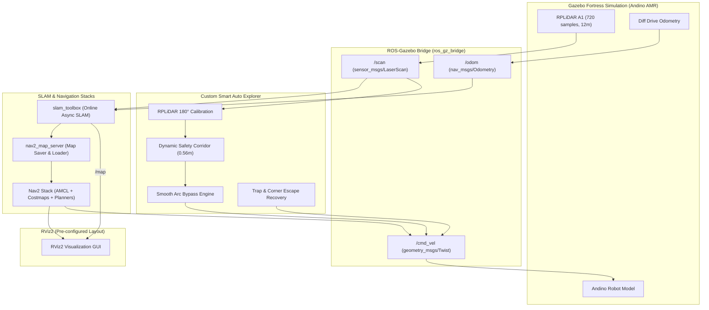

# 🚀 ROS 2 Autonomous SLAM & Navigation with Andino AMR

<div align="center">

[](https://docs.ros.org/en/humble/)
[](https://gazebosim.org/)
[](https://www.docker.com/)
[](https://www.python.org/)
[](https://github.com/SteveMacenski/slam_toolbox)
[](https://navigation.ros.org/)

<p align="center">
  <b>A comprehensive, production-ready framework for 2D SLAM, intelligent autonomous exploration, and Nav2 navigation for mobile robots in ROS 2.</b>
</p>


</div>

---

## 📑 Table of Contents

- [Overview](#-overview)
- [How to Run (Standard Workflow)](#-how-to-run-standard-workflow)
  - [Step 0: GUI Permission](#step-0-gui-permission)
  - [Step 1: Start Docker Container](#step-1-start-docker-container)
  - [Step 2: Terminal 1 — Launch Simulation & Robot](#step-2-terminal-1--launch-simulation--robot)
  - [Step 3: Terminal 2 — Start SLAM Toolbox](#step-3-terminal-2--start-slam-toolbox)
  - [Step 4: Terminal 3 — Autonomous Exploration (`auto_explore`)](#step-4-terminal-3--autonomous-exploration-auto_explore)
  - [Step 5: Save the Generated Map](#step-5-save-the-generated-map)
  - [Step 6: Autonomous Navigation with Nav2](#step-6-autonomous-navigation-with-nav2)
- [Key Features](#-key-features)
- [System Architecture](#-system-architecture)
- [Sensor Calibration & Mathematical Model](#-sensor-calibration--mathematical-model)
- [Alternative Shortcut Runners](#-alternative-shortcut-runners)
- [Project Directory Structure](#-project-directory-structure)
- [Key ROS 2 Topics & Services](#-key-ros-2-topics--services)
- [Troubleshooting & Common Errors](#-troubleshooting--common-errors)
- [Credits & Acknowledgements](#-credits--acknowledgements)

---

## 🌟 Overview

This repository provides an autonomous mobile robotics environment featuring the **Andino AMR** (Autonomous Mobile Robot) in **Gazebo Fortress** and **ROS 2 Humble**.

Equipped with a custom **Smart Autonomous Explorer Node** (`auto_explore.py`), the robot autonomously roams unknown environments, detects dynamic and static obstacles, navigates tight corridors, and maps the entire warehouse without any manual teleoperation. Once mapped, the environment is loaded into the **Nav2** stack for autonomous point-to-point goal navigation, obstacle avoidance, and path planning.

---

## 🚀 How to Run (Standard Workflow)

### Step 0: GUI Permission
Before starting the containers, allow Docker to connect to your X11 display (run this in your host terminal):

```bash
xhost +
```

---

### Step 1: Start Docker Container
Open a terminal in the project directory and start the Docker environment:

```bash
cd ~/Slam
docker compose up
```

> 💡 *Leave this terminal open. The container is now running and ready in the background.*

---

### Step 2: Terminal 1 — Launch Simulation & Robot
Open a **new terminal** and launch the Gazebo simulation with Andino and RViz:

```bash
docker exec -it robotics_essentials_ros2 bash
ros2 launch andino_gz andino_gz.launch.py
```

> ⚠️ **Important:** Once Gazebo opens, click the **Play (▷)** button in the bottom toolbar to start simulation physics!

---

### Step 3: Terminal 2 — Start SLAM Toolbox
Open a **second terminal** and launch the online SLAM mapping node:

```bash
docker exec -it robotics_essentials_ros2 bash
ros2 launch andino_gz slam_toolbox_online_async.launch.py
```

---

### Step 4: Terminal 3 — Autonomous Exploration (`auto_explore`)
Open a **third terminal** and run the autonomous exploration node:

```bash
docker exec -it robotics_essentials_ros2 bash
auto_explore
```

Sit back and watch the robot:
1. Perform an initial $360^\circ$ scan to seed the SLAM map.
2. Autonomously navigate through the warehouse corridors.
3. Dynamically detect and bypass obstacles and corners with smooth arc steering.
4. Build the complete 2D occupancy grid in RViz in real time!

---

### Step 5: Save the Generated Map
When the map is complete, press `Ctrl + C` in Terminal 3 to stop exploration, and save the map:

```bash
ros2 run nav2_map_server map_saver_cli --free 0.15 --fmt png -f $HOME/andino_map
```

*(Map files `andino_map.yaml` and `andino_map.png` will be created in your home directory).*

---

### Step 6: Autonomous Navigation with Nav2
Stop the previous nodes (`Ctrl + C` in terminals 1 & 2), then launch the simulation with Nav2:

```bash
docker exec -it robotics_essentials_ros2 bash
ros2 launch andino_gz andino_gz.launch.py nav2:=True
```

1. **Set Initial Pose**: Click **2D Pose Estimate** in the top RViz toolbar, then click and drag at the robot's approximate position on the map.
2. **Send Goal**: Click **Nav2 Goal** anywhere on the map. The global planner will compute the shortest feasible path, and the local controller will steer the robot around dynamic obstacles to the destination!

---

## ✨ Key Features

- 🤖 **Smart Autonomous Exploration**: Self-driving wanderer node (`auto_explore`) with real-time obstacle avoidance, smooth arc contour steering, and corner trap escape recovery.
- 📐 **Rigorous Sensor Frame Calibration**: Solves the physical RPLiDAR $180^\circ$ yaw mounting inversion using real-time Cartesian transforms into `base_link`.
- 🗺️ **State-of-the-Art 2D SLAM**: Powered by `slam_toolbox_online_async` with online pose-graph optimization and robust loop closure.
- 🎯 **Complete Nav2 Integration**: Global & local costmaps, DWB trajectory controller, AMCL particle filter localization, and behavior recovery trees.
- 🖥️ **Pre-Configured RViz2**: Custom layout displaying Map, LaserScan, TF frames, and costmap layers with no manual setup needed.
- 🐳 **100% Dockerized**: Zero dependency headaches. Everything runs in isolated Ubuntu 22.04 + ROS 2 Humble containers with hardware-accelerated GPU passthrough.

---

## 🏗️ System Architecture



---

## 🧮 Sensor Calibration & Mathematical Model

### The RPLiDAR $180^\circ$ Inversion Challenge
On physical differential drive robots (including Andino), LiDAR sensors are frequently mounted facing backward ($180^\circ$ yaw rotation) to route USB and power cables toward the robot's interior:

$$\text{Joint Transform: } \quad \text{rpy} = (0,\, 0,\, \pi)$$

When processing raw laser beams without coordinate transformation, angle $\theta = 0$ corresponds to the **rear** of the robot, causing the robot to mistakenly treat front walls as non-existent!

### Body Frame Cartesian Mapping
The `auto_explore` node resolves this by transforming all 720 beam samples directly into the robot's actual motion frame (`base_link`):

$$\begin{cases}
x_{\text{robot}} = -r \cdot \cos(\theta_{\text{laser}}) + 0.05 \\[4pt]
y_{\text{robot}} = -r \cdot \sin(\theta_{\text{laser}})
\end{cases}$$

Where:
- $x_{\text{robot}} > 0$: **Forward ahead**
- $y_{\text{robot}} > 0$: **Left flank**
- $y_{\text{robot}} < 0$: **Right flank**

### Dynamic Safety Corridor
An active safety corridor of width $W = 0.56\text{ m}$ ($|y_{\text{robot}}| < 0.28\text{ m}$) monitors the vehicle's clearance:
- **$x_{\text{robot}} < 0.45\text{ m}$ (Critical Zone)**: $v = 0$, immediate high-speed rotation on the spot.
- **$0.45\text{ m} \le x_{\text{robot}} < 0.95\text{ m}$ (Bypass Zone)**: Smooth speed deceleration coupled with dynamic arc steering:

$$v = v_{\text{min}} + \left(\frac{x_{\text{min}} - d_{\text{crit}}}{d_{\text{slow}} - d_{\text{crit}}}\right) \cdot (v_{\text{max}} - v_{\text{min}})$$

$$\omega = (1 - \text{speed\_ratio}) \cdot \omega_{\text{max}} \cdot \text{dir}_{\text{clearance}} + \omega_{\text{wall\_repulse}}$$

---

## ⚡ Alternative Shortcut Runners

If you prefer one-click host execution without manually attaching to Docker, you can run the helper scripts directly from your host machine:

| Step | Script | Action |
|:---:|:---|:---|
| **1** | `./1_start_sim.sh` | Launches Gazebo world (`depot.sdf`) & pre-configured RViz2 |
| **2** | `./2_start_slam.sh` | Launches `slam_toolbox` online asynchronous mapping |
| **3** | `./3_auto_explore.sh` | Launches the autonomous obstacle-avoidance & exploration node |
| **4** | `./4_save_map.sh` | Saves the generated 2D occupancy map (`.yaml` + `.png`) |
| **5** | `./5_start_navigation.sh` | Starts the Nav2 autonomous goal-navigation stack |

---

## 📂 Project Directory Structure

```plaintext
Slam/
├── 0-setup/                   # Installation and Docker setup tutorials
├── 1-ros_2_introduction/      # Fundamental ROS 2 exercises (topics, tf)
├── 2-slam_and_navigation_demo/ # SLAM and Nav2 exercises
├── 3-create_ros_2_package/    # Custom package creation guide
├── 4-robot_odometry/          # Odometry calculation and wheel kinematics
├── 5-path_planning/           # Nav2 planner plugin development
├── docker/                    # Dockerfile, dependencies & docker-compose
│   ├── Dockerfile
│   ├── docker-compose.yaml
│   └── ros_entrypoint.sh
├── images/                    # Demo illustrations, diagrams, and gifs
├── packages/                  # ROS 2 packages (custom_nav2_planner, msgs)
├── auto_explore.py            # 🧠 Intelligent autonomous exploration node
├── 1_start_sim.sh             # 🚀 Runner: Gazebo & RViz2
├── 2_start_slam.sh            # 🗺️ Runner: Slam-Toolbox
├── 3_auto_explore.sh          # 🤖 Runner: Autonomous exploration
├── 3_teleop.sh                # ⌨️ Runner: Manual keyboard teleop (optional)
├── 4_save_map.sh              # 💾 Runner: Save 2D map
├── 5_start_navigation.sh      # 🧭 Runner: Nav2 autonomous navigation
├── docker-compose.yaml        # Root Docker Compose file
└── README.md                  # Project documentation
```

---

## 📡 Key ROS 2 Topics & Services

| Name | Type | Description |
|:---|:---|:---|
| `/scan` | `sensor_msgs/msg/LaserScan` | 2D LiDAR point measurements (720 samples, $360^\circ$) |
| `/cmd_vel` | `geometry_msgs/msg/Twist` | Differential drive velocity commands ($v_x, \omega_z$) |
| `/odom` | `nav_msgs/msg/Odometry` | Wheel encoder odometry ground truth |
| `/map` | `nav_msgs/msg/OccupancyGrid` | 2D occupancy grid generated by SLAM |
| `/tf`, `/tf_static` | `tf2_msgs/msg/TFMessage` | Coordinate frame tree (`map` $\to$ `odom` $\to$ `base_link` $\to$ `rplidar_laser_link`) |
| `/map_server/load_map` | `nav2_msgs/srv/LoadMap` | Service to dynamically load custom maps into Nav2 |

---

## 🔧 Troubleshooting & Common Errors

<details>
<summary><b>1. "Authorization required, but no authorization protocol specified" or "libEGL warning: failed to open /dev/dri/renderD128: Permission denied"</b></summary>

This error occurs when the container cannot access the host's X11 display server or GPU rendering device.
**Fix**: Run `xhost +` in a host terminal before running the simulation:
```bash
xhost +
```
Additionally, `/dev/dri` and user video group permissions have already been configured in `docker-compose.yaml`.
</details>

<details>
<summary><b>2. Gazebo window freezes or robot does not move</b></summary>

Make sure physics simulation is active in Gazebo by pressing the **Play (▷)** button in the lower toolbar.
</details>

<details>
<summary><b>3. Custom Map Loading into Nav2</b></summary>

To load your newly saved map into the running Nav2 session without relaunching:
```bash
docker exec -it robotics_essentials_ros2 /ros_entrypoint.sh \
  ros2 service call /map_server/load_map nav2_msgs/srv/LoadMap "{map_url: /home/user/andino_map.yaml}"
```
</details>

---

## 👥 Credits & Acknowledgements

- **Maintained & Enhanced by**: [Alireza Akbari](https://github.com/Alirezakbari)
- **Course Originator**: Adapted from ROS 2 coursework at Arak University of Technology by [Dr. Kaveh Hooshmandi](https://github.com/kaveh-hooshmandi).
- **Original Authors**: Janne Karttunen, George-Cosmin Porusniuc, and Prof. Ilkka Jormanainen (University of Eastern Finland).
- **Robot Platform**: Andino AMR simulation developed by [Ekumen](https://github.com/Ekumen-OS).

---

<div align="center">
  <b>⭐ If you find this project helpful, please consider starring the repository! ⭐</b>
</div>
